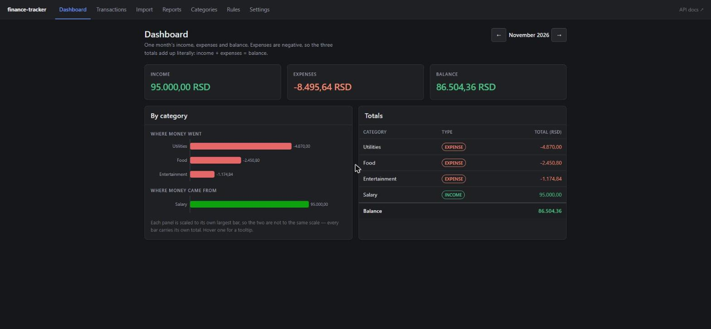
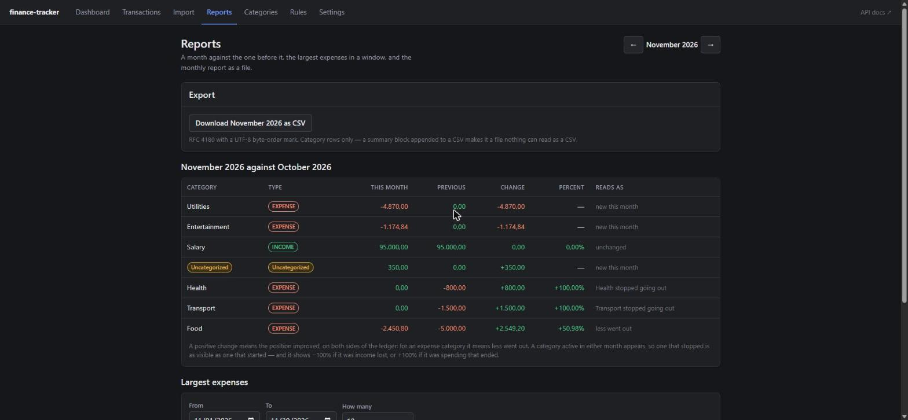
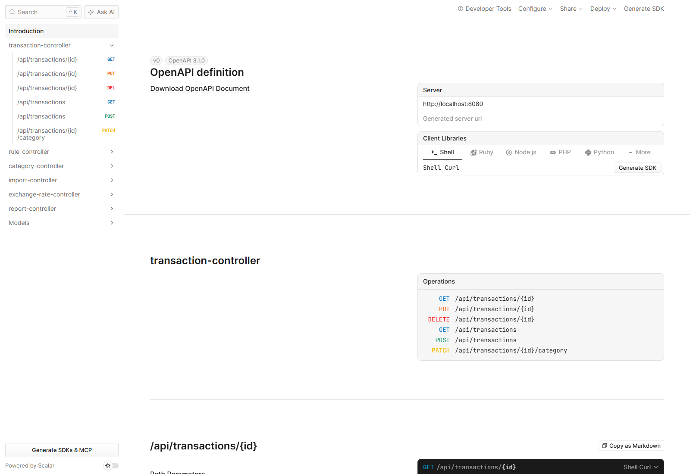
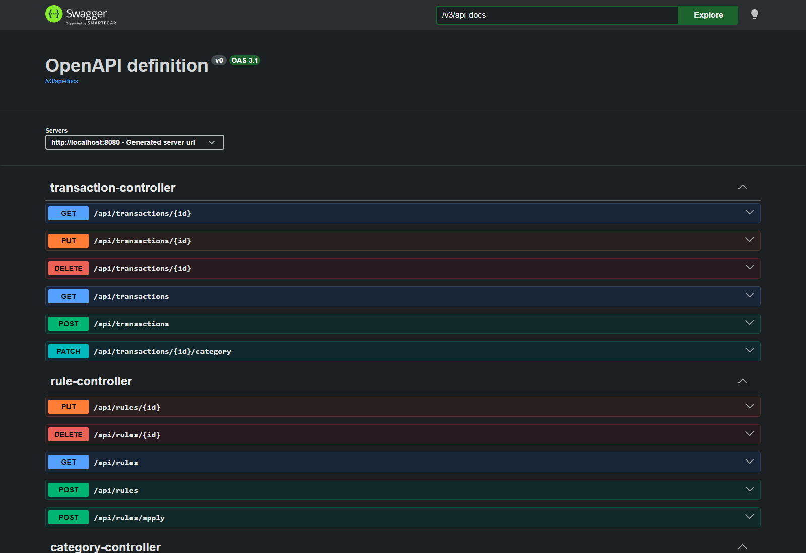

# finance-tracker

[](https://github.com/igorpujovic/finance-tracker/actions/workflows/build.yml)

A web application and REST API that imports bank statements from CSV files, cleans and
categorizes the transactions, and reports monthly spending in Serbian dinars.

It is a small ETL pipeline with a REST surface: rows are extracted from a statement, validated and
converted, loaded into PostgreSQL, and reported on with SQL aggregations. Everything a statement
does is explainable afterwards — every upload keeps its summary and its rejected lines, verbatim,
with the reason each one was refused.

**Stack**: Java 21, Spring Boot 4.2, Spring Data JPA, PostgreSQL 18, Flyway, Apache Commons CSV,
springdoc-openapi, JUnit 5, Testcontainers, Docker Compose, GitHub Actions — and a React 19 +
TypeScript client, built by Maven into the application's own jar.

- [Run it](#run-it)
- [The web client](#the-web-client)
- [Two things that read as bugs](#two-things-that-read-as-bugs)
- [The sample statement](#the-sample-statement)
- [API](#api)
- [API documentation](#api-documentation)
- [Exchange rates](#exchange-rates)
- [Known limitations](#known-limitations)
- [Development](#development)

## Run it

Docker is the only prerequisite — no local JDK, no local PostgreSQL, no manual setup between
cloning and a populated report.

```sh
git clone https://github.com/igorpujovic/finance-tracker.git
cd finance-tracker
docker compose up --build --wait
```

That builds the application, starts PostgreSQL 18, runs the Flyway migrations — which seed seven
categories and seven categorization rules, so the pipeline has something to categorize with on the
first run — and waits until the API actually answers requests.

Then open **<http://localhost:8080>** and drop a statement on the Import page —
`src/test/resources/statements/sample.csv` is in this repository and is deliberately imperfect.

The same thing without a browser — upload the sample statement and read the report it produces:

```sh
curl -F file=@src/test/resources/statements/sample.csv http://localhost:8080/api/imports
curl 'http://localhost:8080/api/reports/monthly?year=2026&month=11'
```

```json
{"id":1,"fileName":"sample.csv","importedAt":"2026-11-21T13:21:49.665369Z",
 "totalRows":7,"importedRows":4,"duplicateRows":1,"rejectedRows":2}
```

```json
{
  "year": 2026, "month": 11,
  "income": 95000.00, "expenses": -8495.64, "balance": 86504.36,
  "categories": [
    {"categoryId": 4, "categoryName": "Utilities",     "categoryType": "EXPENSE", "totalRsd": -4870.00},
    {"categoryId": 3, "categoryName": "Food",          "categoryType": "EXPENSE", "totalRsd": -2450.80},
    {"categoryId": 6, "categoryName": "Entertainment", "categoryType": "EXPENSE", "totalRsd": -1174.84},
    {"categoryId": 1, "categoryName": "Salary",        "categoryType": "INCOME",  "totalRsd": 95000.00}
  ]
}
```

Nothing in that was configured: the category names come from the seeded reference data, the
Entertainment row is the Netflix line in euros converted at the National Bank's rate for its own
date, and the two lines the file got wrong are in `GET /api/imports/1` rather than in the report.

That euro line is the one part of the walkthrough that needs the internet — the rate for its date
is fetched from the Kurs API during the import, and a statement in dinars alone needs nothing
beyond the two containers.

Credentials default to `finance` / `finance` / `finance_tracker` and are overridable in `.env` —
copy `.env.example` if you want to change them. `docker compose down -v` removes the data volume
and returns the database to a fresh clone's state.

## The web client

A React 19 + TypeScript client covering **all 23 endpoints**, so nothing in this project is
reachable only by `curl`. It is served by the application itself, at `/`, on the same port as the
API.



| Page | What it does |
| --- | --- |
| **Dashboard** | The month's income, expenses and balance, with the category breakdown as a table and a chart |
| **Transactions** | The paged ledger with all five filters, plus create, edit, delete and a per-row category dropdown |
| **Import** | Drop a CSV, see the summary, and browse every past upload |
| **Import detail** | One batch and its rejected lines, verbatim, with the reason each was refused |
| **Reports** | The comparison against last month, the largest expenses in a window, and the CSV export |
| **Categories** / **Rules** | CRUD for both, and "apply the rules to every uncategorized transaction" |
| **Settings** | Download today's exchange rates on demand |

There is **one artifact and one origin**: Maven builds the client into the jar's static
resources, so `docker compose up` still starts everything, there is no second service, and there
is no CORS configuration anywhere in this project
([ADR-0008](docs/adr/0008-the-client-is-built-by-maven-and-served-from-the-jar.md)).

The client renders the two conventions that read as bugs rather than smoothing them over. Nothing
in it takes an absolute value, and the comparison says out loud which way each row should be read:



Food is `+2.549,20` and `+50,98%` — *less went out*. Transport and Health stopped entirely and are
`+100%`; a salary that stopped would be `−100%`. Utilities and Entertainment have no previous
month to be a percentage of, so their percent is **`—`** and not `0%`. The refund that no rule
could claim sits in its own **Uncategorized** row, with its money still counted.

### Working on it

```sh
docker compose up -d postgres     # the database
./mvnw spring-boot:run            # the API on :8080

cd frontend && npm install
npm run dev                       # the client on :5173, proxying /api to :8080
npm test                          # vitest
```

The dev server proxies `/api` so the client fetches the same relative paths in development as in
production. `./mvnw test -P backend-only` skips the client entirely when you are working on the
Java side.

## Two things that read as bugs

**Expenses are negative numbers.** There is no `type` column anywhere in this project: a
transaction's income-or-expense nature *is* the sign of its amount, and nothing else marks it
([ADR-0002](docs/adr/0002-money-stays-signed-end-to-end.md)). Reports keep that sign, so a monthly
report says `"expenses": -8495.64` and not `8495.64`, and the three totals add up literally:

```
income + expenses = balance        95000.00 + (-8495.64) = 86504.36
```

The alternative — storing magnitudes and a type flag — means every query that sums money has to
know which rows to negate, and gets it wrong exactly once, in the one place nobody tested. Here
`sum(amount_rsd)` is the balance, in every query, with no case analysis at all.

**A positive percent change means the position improved.** In the comparison report, `change` is
`current - previous` on signed amounts, so for an expense category spending *less* is a positive
number. Food below: 5000 dinars spent in October, 2450.80 in November.

```json
{"categoryName": "Food", "categoryType": "EXPENSE",
 "current": -2450.80, "previous": -5000.00, "change": 2549.20, "percent": 50.98}
```

Read it as "Food is 50.98% better than last month", not as "spending rose by half". The same
arithmetic reads naturally for income, where more money is also a positive change — which is the
point: one rule covers both, with no case analysis and no category of exception.

It follows that a category which stopped entirely does **not** always show `-100`. Salary that
stopped is `-100%`, because losing an income is a loss; a bus pass that stopped is `+100%`,
because no longer spending that money is an improvement of exactly the amount that was being
spent. Both mean "nothing this month", and the sign says which of the two it was.

A `percent` of `null` means the previous month was zero, which no percentage can describe. A
category that appears in either month appears in the report, so a category that stopped is as
visible as one that started.

## The sample statement

`src/test/resources/statements/sample.csv` is the reference file, and deliberately imperfect: it
contains one duplicate pair and two unusable lines.

```csv
date,description,amount,currency
01.11.2026,PLATA OKTOBAR,95000.00,RSD
03.11.2026,MAXI 245 BEOGRAD,-2450.80,RSD
04.11.2026,"NETFLIX.COM, AMSTERDAM",-9.99,EUR
05.11.2026,EPS SNABDEVANJE,-4870.00,RSD
05.11.2026,EPS SNABDEVANJE,-4870.00,RSD
31.11.2026,BUS PLUS DOPUNA,-1500.00,RSD
07.11.2026,LIDL 112,abc,RSD
```

Expected summary — **total 7, imported 4, duplicate 1, rejected 2** — which is asserted as a test
as well as being what the walkthrough above returns:

| Line | What happens | Why |
| --- | --- | --- |
| `PLATA OKTOBAR` | imported, Salary | the `PLATA` rule |
| `MAXI 245 BEOGRAD` | imported, Food | the `MAXI` rule |
| `NETFLIX.COM, AMSTERDAM` | imported, Entertainment | quoted comma kept; EUR converted at 2026-11-04's rate |
| `EPS SNABDEVANJE` | imported, Utilities | the `EPS` rule |
| `EPS SNABDEVANJE` | **duplicate** | identical to the line above it, in the same file |
| `BUS PLUS DOPUNA` | **rejected** | the 31st of November is not a date |
| `LIDL 112` | **rejected** | `abc` is not an amount |

A rejected line never stops an import. Both are kept with their line number and the original text:

```json
"errors": [
  {"rowNumber": 7, "rawLine": "31.11.2026,BUS PLUS DOPUNA,-1500.00,RSD",
   "reason": "the date is not a real date written as dd.MM.yyyy"},
  {"rowNumber": 8, "rawLine": "07.11.2026,LIDL 112,abc,RSD",
   "reason": "the amount is not a number"}
]
```

The statement format is UTF-8, a header row, and four comma-separated columns: `date` as
`dd.MM.yyyy`, `description` quoted if it contains a comma, `amount` with a dot and a minus sign
for expenses, `currency` as a 3-letter ISO code. The column mapping lives in one class
(`StatementColumns`) so another bank's export can be supported without touching the importer.

## API

23 endpoints across six controllers.

| Method | Route | Purpose |
| --- | --- | --- |
| GET | `/api/categories` | List |
| POST | `/api/categories` | Create |
| PUT | `/api/categories/{id}` | Update |
| DELETE | `/api/categories/{id}` | Delete an unused category |
| GET | `/api/transactions` | List with filters |
| GET | `/api/transactions/{id}` | Get one |
| POST | `/api/transactions` | Create a manual transaction |
| PUT | `/api/transactions/{id}` | Update |
| PATCH | `/api/transactions/{id}/category` | Change only the category |
| DELETE | `/api/transactions/{id}` | Delete |
| GET | `/api/rules` | List |
| POST | `/api/rules` | Create |
| PUT | `/api/rules/{id}` | Update |
| DELETE | `/api/rules/{id}` | Delete |
| POST | `/api/rules/apply` | Apply the rules to every uncategorized transaction |
| POST | `/api/imports` | Upload a CSV, return the summary |
| GET | `/api/imports` | List past imports |
| GET | `/api/imports/{id}` | One import with its rejected lines |
| GET | `/api/reports/monthly` | Totals per category |
| GET | `/api/reports/comparison` | Change against the previous month |
| GET | `/api/reports/top-expenses` | Largest expenses in a window |
| GET | `/api/reports/monthly/export` | Monthly report as CSV |
| POST | `/api/exchange-rates/refresh` | Download today's rates |

**Query parameters.** `/api/transactions` takes `from`, `to`, `categoryId`, `type`,
`uncategorized`, `page`, `size`, `sort` — page size 20 by default and 100 at most, sorted by date
then id, newest first. `/api/reports/monthly`, `/api/reports/monthly/export` and
`/api/reports/comparison` take `year` and `month`. `/api/reports/top-expenses` takes `from`, `to`
and `limit` — 10 by default, 100 at most, negative amounts only, uncategorized included.

**Errors** are one shape, from one `@RestControllerAdvice`: 400 for validation (with a
`fieldErrors` map), 404 for a missing row, 409 for a conflict such as deleting a category that
still holds money, and 503 when the National Bank cannot be reached.

```json
{"timestamp":"2026-11-21T13:23:28.407955947Z","status":400,"error":"Bad Request",
 "message":"no exchange rate for ZWL on 2026-11-04"}
```

**The CSV export** is RFC 4180 with a UTF-8 byte-order mark, so Serbian category names survive a
double-click into Excel. Category rows only, no summary block — a file with a summary block
appended is no longer a CSV anything can read:

```csv
category,type,total_rsd
Utilities,EXPENSE,-4870.00
Food,EXPENSE,-2450.80
Entertainment,EXPENSE,-1174.84
Salary,INCOME,95000.00
```

## API documentation

One OpenAPI document, two viewers, both served by the running application:

- **Scalar** — <http://localhost:8080/scalar>
- **Swagger UI** — <http://localhost:8080/swagger-ui.html>
- The document itself — <http://localhost:8080/v3/api-docs>





## Exchange rates

Foreign lines are converted to dinars at the official National Bank of Serbia rate for the
transaction's own date, read from the [Kurs API](https://kurs.resenje.org) (no key required).

- Rates exist only for working days. The rate in force on a weekend or a holiday is the most
  recent earlier one, which is one SQL query — `most recent on or before` — and the reason there
  is no holiday calendar anywhere in this project.
- A scheduled job warms today's rates on working mornings, and `POST /api/exchange-rates/refresh`
  does the same on demand.
- A statement from last year does not depend on that job having run: an import resolves the dates
  it is missing before it opens a database transaction, downloading once per missing date
  ([ADR-0005](docs/adr/0005-rates-are-resolved-before-the-import-transaction-opens.md)).
- A transaction entered or corrected by hand converts the same way and under the same ordering:
  `POST` and `PUT /api/transactions` resolve the one currency-and-date pair the request names
  before the write opens, so an imported foreign row can be amended in the currency it came with
  rather than only by a claim that it was in dinars.
- A currency the bank does not publish rejects **that source line**, with the reason. A request
  carrying a single transaction has nothing else in it, so the same reason comes back as a 400 —
  and the same goes for a conversion too large or too small for the dinar column.
- A network failure is not the line's fault and aborts the **whole upload** with 503, writing
  nothing — upload the same file again when the bank is back. A manual request answers 503 the
  same way and stores nothing, because the rate is resolved before the row is written.

## Known limitations

Every one of these is a deliberate trade-off rather than an unknown, and each would change the
data model to fix.

**Two identical payments on the same day count as one.** A source line is recognised by a
fingerprint over its date, description, amount and currency
([ADR-0003](docs/adr/0003-a-fingerprint-identifies-a-source-line.md)) — the only four things a
bank export gives us. Two coffees at the same café, for the same amount, on the same day are
indistinguishable from the same coffee exported twice, and the second one is counted as a
duplicate and skipped. The import summary says `duplicateRows: 1` rather than hiding it, and a
genuine second payment can be added by hand.

**Refunds stay uncategorized.** A refund is income carrying the merchant name of the expense it
undoes, so the `MAXI` rule matches it — and is then discarded, because an expense category cannot
take income ([ADR-0004](docs/adr/0004-category-type-filters-rules-before-priority-ranks-them.md)).
That is the right half of the behaviour: filing a refund under Food would corrupt the Food total
in both directions. The missing half is a rule that recognises it as a refund, which needs more
than a keyword, so a refund lands in the uncategorized row of the report until someone assigns it
with `PATCH /api/transactions/{id}/category`. The seeded `POVRACAJ` rule only catches the refunds
whose description says so in words.

**Deleting a transaction and re-importing its statement brings it back.** The fingerprint lives on
the transaction row, so deleting the row deletes the memory that the source line was ever
imported, and the next upload of that file imports it again as new. Deletion is a correction of
the database, not of the statement.

**One user, no accounts, no authentication.** The API and the web client are a single person's
ledger, and neither is exposed to the internet by this compose file. Users were dropped from the
roadmap deliberately: the sibling portfolio project already argues JWT, and adding a login screen
to an application with nothing to authenticate against would be theatre. Anyone who can reach
port 8080 can read and change everything, which is a decision and not an oversight.

## Development

```sh
docker compose up -d postgres     # the database alone, for running the app from an IDE
./mvnw test                       # the whole suite — 174 Java tests and 47 client tests
./mvnw verify                     # and the jar the Dockerfile copies, client included
./mvnw test -P backend-only       # skip the client: no Node download, no client build
```

`./mvnw test` runs both suites, because a client that renders an expense without its minus sign
is as broken as a query that sums it wrongly, and one command should say so. The client's build
also typechecks before it bundles, so a TypeScript error fails the Maven build rather than
reaching the browser. Node is downloaded by the build into `frontend/node` and is not a
prerequisite ([ADR-0008](docs/adr/0008-the-client-is-built-by-maven-and-served-from-the-jar.md)).

The tests need a Docker daemon: everything query-shaped runs against a real PostgreSQL 18 in
Testcontainers rather than against an in-memory stand-in
([ADR-0006](docs/adr/0006-query-shaped-logic-is-tested-against-a-real-postgresql.md)), because what
this project decides, it decides in SQL and in check constraints. One container is started once
and shared by the whole suite, and the Kurs API is faked at the HTTP boundary — a real server on
loopback serving real 503s and real timeouts, because the distinction the import rests on is a
distinction between HTTP outcomes.

Every one of the specification's sixteen business rules has at least one test that fails if the
rule is broken. The suite covers parsing, fingerprinting, rule selection and conversion arithmetic
in plain JUnit, and everything else through the endpoints.

**The build compiles twice, on purpose.** `maven-compiler-plugin` is configured with a
metamodel-generating pass and a forked, processor-free compiling pass. Without that, roughly every
other clean build wrote class files naming project classes without their package — a green build
producing an application that could not start
([ADR-0007](docs/adr/0007-the-metamodel-is-generated-by-one-compilation-and-consumed-by-another.md)).
Please read that ADR before tidying the pom.

**CI** runs on every push: `./mvnw verify` on a runner with a Docker daemon, the miscompiled-class
detector from ADR-0007 over the compiled output, then a real `docker compose up` that uploads a
statement to a clean database and reads the report back through HTTP. That last job uploads a
dinar-only statement rather than `sample.csv`, so that an outage at the National Bank cannot turn
a commit that changed nothing into a red build; the euro path is covered by the suite, where Kurs
is faked at the HTTP boundary.

### Where things are written down

| File | What it holds |
| --- | --- |
| [`GLOSSARY.md`](GLOSSARY.md) | The project's vocabulary — what a *source line*, a *dinar amount* and a *duplicate* mean here |
| [`docs/adr/`](docs/adr) | The eight decisions that shaped the data model, the build and the client |
| [`.scratch/finance-tracker/spec.md`](.scratch/finance-tracker/spec.md) | The specification, its 16 business rules, and the 17 deviations from the original |
